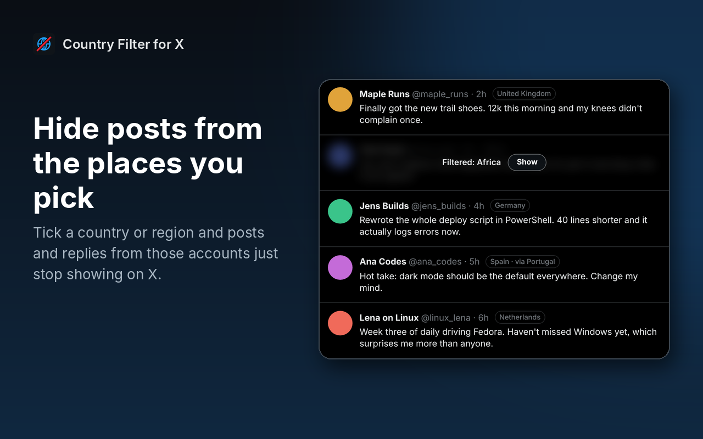
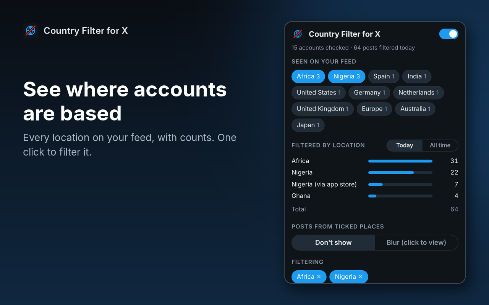
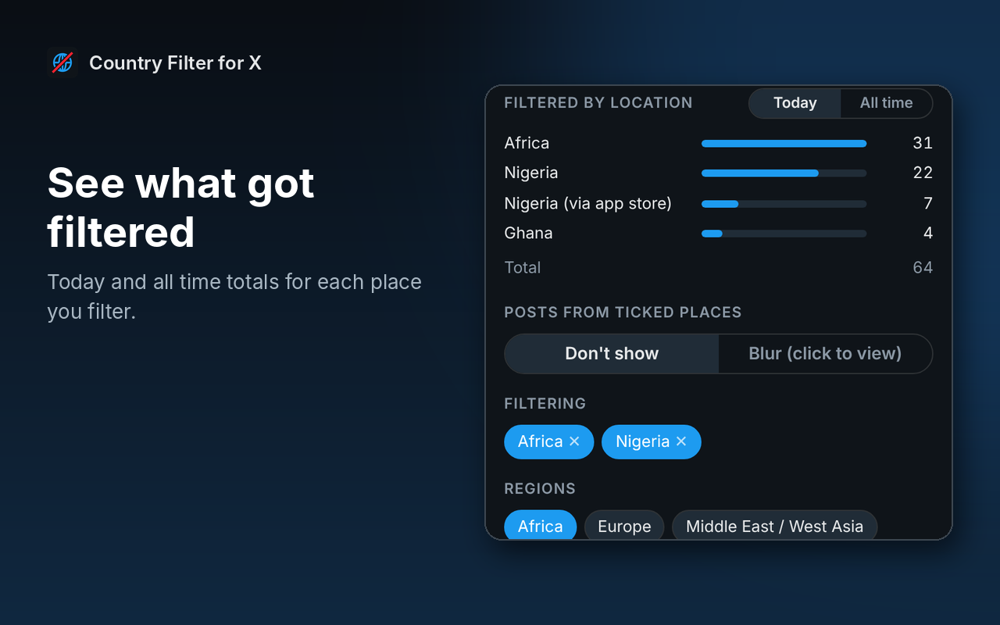
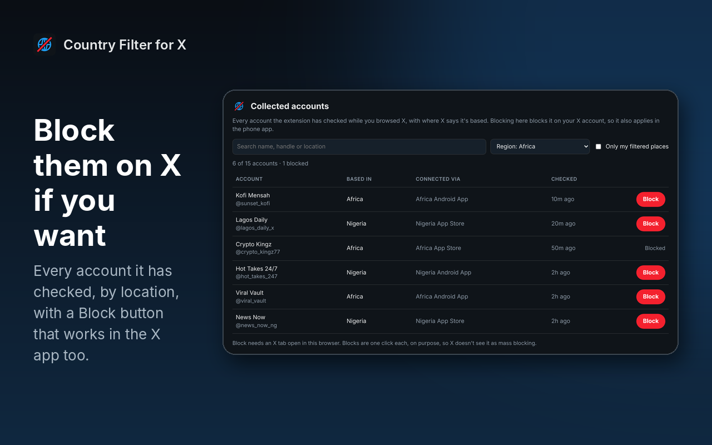

# Country Filter for X

Hide X posts and replies from the countries or regions you choose. X shows where every account is based on its "About this account" page, and Country Filter for X uses that right on your feed.

**Download and full guide:** https://techygeekshome.info/browser-extensions/country-filter-for-x/

**Watch the demo:** https://www.youtube.com/watch?v=Eq6_1ePb6TY

## Screenshots

| | |
|---|---|
|  |  |
|  |  |

## What it does

- **Hides posts and replies** from accounts based in the countries or regions you tick. Or **blurs** them instead, with a Show button.
- **Location tag next to every name**, so you can see where accounts are based as you scroll.
- **Seen on your feed**: every location it has come across, with counts. Click one to filter it.
- **Filtered by location**: how many posts it has filtered from each place, today and all time.
- **Regions as well as countries.** Some accounts only show a region, like "Africa", so you can filter a whole region in one go.
- **"Connected via" match** (optional): also filters by the app store an account signed up from, which catches some accounts using a VPN to look like they're somewhere else.
- **Never hide list** for accounts you always want to see.
- **Collected accounts page** (optional): every account it has checked, by location, with a one-click **Block** button. Blocks go on your X account, so they also apply in the X phone app.

## What it won't do

- It isn't 100% accurate. It uses the location X shows, which can be wrong (for example, because of VPNs).
- It can't filter the X phone app. Only accounts you block carry over to the app.
- It doesn't block anyone on its own. Blocking is one click per account, on purpose.

## Good to know

X allows about 50 account lookups every 15 minutes. Country Filter for X only looks up posts that are on your screen, stops just before the limit and remembers every account for 30 days, so after a day or so most of your feed is already known. Accounts it already knows are filtered straight away, even while lookups are paused.

## Install

Pick the download for your browser from the [latest release](https://github.com/techygeekshome/CountryFilterForX/releases/latest).

| Browser | Download |
|---|---|
| Chrome, Brave, Opera, Vivaldi | `CountryFilterForX-chrome.zip` |
| Microsoft Edge | `CountryFilterForX-edge.zip` |
| Firefox (128 or newer) | `CountryFilterForX-firefox.zip` |

`CountryFilterForX.zip` is the same package as the Chrome and Edge downloads.

### Chrome, Edge, Brave, Opera and Vivaldi

1. Unzip the download somewhere you'll keep it.
2. Open `chrome://extensions` (or `edge://extensions`).
3. Turn on **Developer mode**.
4. Click **Load unpacked** and pick the `country-filter-for-x` folder.
5. Refresh x.com.

### Firefox

1. Open `about:debugging#/runtime/this-firefox`.
2. Click **Load Temporary Add-on** and pick `CountryFilterForX-firefox.zip`.

Firefox removes temporary add-ons when it closes.

### Build it yourself

The code in this repo is the Chromium version. `manifest.firefox.json` is the Firefox manifest. Run `./build.sh` to make every package in `dist/`.

## Use

1. Sign in to x.com and scroll your feed for a minute. Location tags appear next to names.
2. Click the Country Filter for X icon. Tick a region, a place under **Seen on your feed**, or type a country.
3. Pick **Don't show** or **Blur**. Posts from those places disappear straight away.
4. Click **Collected accounts** to see every account it has checked, and block any you want.

## How it works

- `page.js` runs inside x.com, so lookups use your own signed-in session, the same way x.com does. It asks X for the "About this account" details (Account based in, Connected via) of accounts whose posts are on your screen.
- `content.js` watches the feed, adds the location tags and hides or blurs posts that match your choices.
- `regions.js` maps countries to regions, so ticking a region also matches its countries.
- The Collected accounts page (`list.html`) asks your open x.com tab to block an account only when you click Block.

## Privacy

Country Filter for X has no account, no analytics and no servers. It only talks to x.com, using your own session. Your settings, the accounts it has checked and the filter counts are stored in your own browser. See [PRIVACY.md](PRIVACY.md).

## Licence

GPL-3.0. Free for everyone, including commercial use.

Country Filter for X is an independent tool made by [TechyGeeksHome](https://techygeekshome.info). It isn't made by or connected to X Corp.
